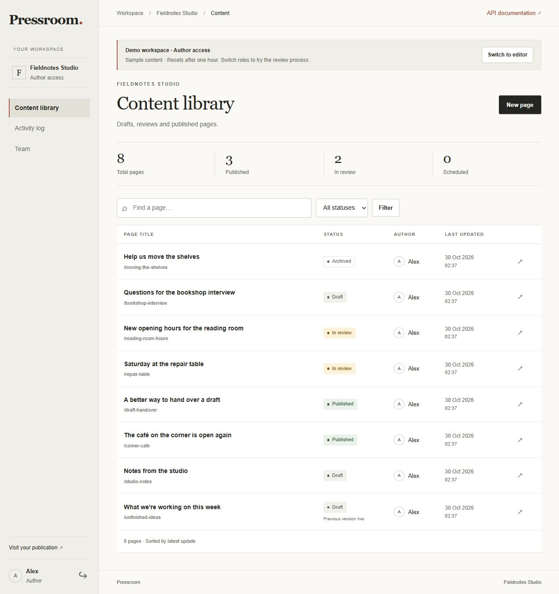
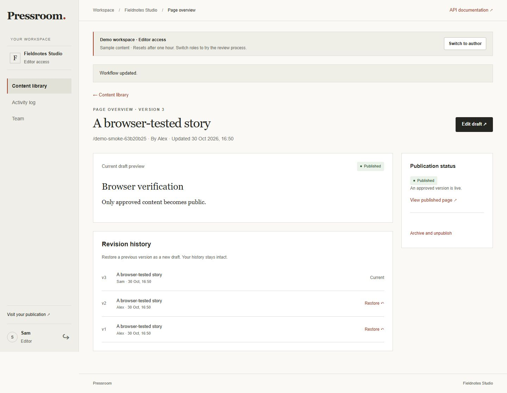
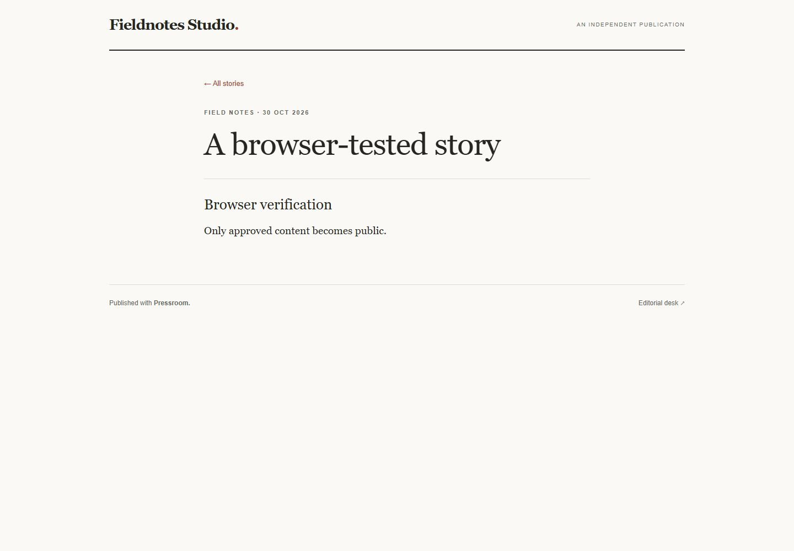

# Pressroom

A Django CMS for small editorial teams. Write a draft, send it for review, and publish an approved version. Later edits stay private until they are approved.

**[Try the live demo](https://pressroom-demo-mohamedajab.vercel.app/demo/)** · [CI](https://github.com/Mohamedajab/pressroom/actions/workflows/ci.yml) · [API guide](docs/api.md)

Each visitor gets a separate workspace with sample stories, revision history and author/editor switching. No signup is needed. The workspace expires after an hour.

[](https://pressroom-demo-mohamedajab.vercel.app/demo/)

## Features

- Workspace permissions with owner, editor, author and viewer roles.
- Draft, review, published, scheduled and archived states.
- Public pages read the approved revision; draft changes stay private.
- Revision restore, edit conflict detection and an activity log.
- REST API with session/token authentication and OpenAPI docs.
- Markdown rendering with HTML sanitization.

## Run locally

Python 3.12 or newer. SQLite works for a quick start; PostgreSQL is used in Docker and CI.

```bash
git clone https://github.com/Mohamedajab/pressroom.git
cd pressroom
python -m venv .venv
source .venv/bin/activate
pip install -r requirements-dev.txt
python manage.py migrate
DEMO_ENABLED=true python manage.py runserver
```

On Windows PowerShell, use `.\.venv\Scripts\Activate.ps1` to activate the environment and `$env:DEMO_ENABLED='true'` before running `python manage.py runserver`.

Open [localhost:8000/demo/](http://localhost:8000/demo/). API docs are at `/api/docs/` and database health is at `/health/`.

For a persistent local workspace, run `python manage.py bootstrap_workspace my-studio --name "My Studio" --username owner`. It prompts for a password when creating an account. The local-only `seed_demo` command is also available; see [deployment notes](docs/deployment.md).

## Screens

| Review and revisions | Public publication |
| --- | --- |
|  |  |

[Demo start](docs/screenshots/demo-start.jpg) · [Sign in](docs/screenshots/login.jpg) · [Mobile](docs/screenshots/demo-mobile.jpg)

## Checks

```bash
pytest
python manage.py check
python manage.py makemigrations --check --dry-run
ruff check .
ruff format --check .
```

SQLite skips the two PostgreSQL concurrency tests. CI tests with PostgreSQL on Python 3.12 and 3.13. Browser checks are in `scripts/demo_smoke.py` and `scripts/browser_smoke.py`.

## Deployment

The live demo uses Vercel and Neon PostgreSQL. Vercel runs `python manage.py migrate --noinput` during builds and serves collected static files. Configure `DEBUG=false`, `DEMO_ENABLED=true`, a random `SECRET_KEY`, `DATABASE_URL`, `ALLOWED_HOSTS`, `CSRF_TRUSTED_ORIGINS`, and `TRUST_PROXY=true` behind Vercel's proxy.

The live demo supports manual publishing. Scheduled publication needs a separate scheduler running `python manage.py publish_due`; it is not configured on the current Vercel deployment. Expired visitor workspaces are cleaned when a new demo starts.

For Docker/PostgreSQL and other hosts, see [deployment](docs/deployment.md) and [hosted demo setup](docs/hosted-demo.md).

## Code and scope

Templates and the REST API call the same functions in `publishing/services.py`. Changes, revisions and audit events commit together. PostgreSQL row locks and version checks protect concurrent edits.

See [architecture](docs/architecture.md), [API routes](docs/api.md), and [contributing](CONTRIBUTING.md).

This is a portfolio project. It does not include uploads, email invitations, SSO or billing. API rate limits use a per-worker memory cache. Use a shared cache before scaling.

MIT licensed.
