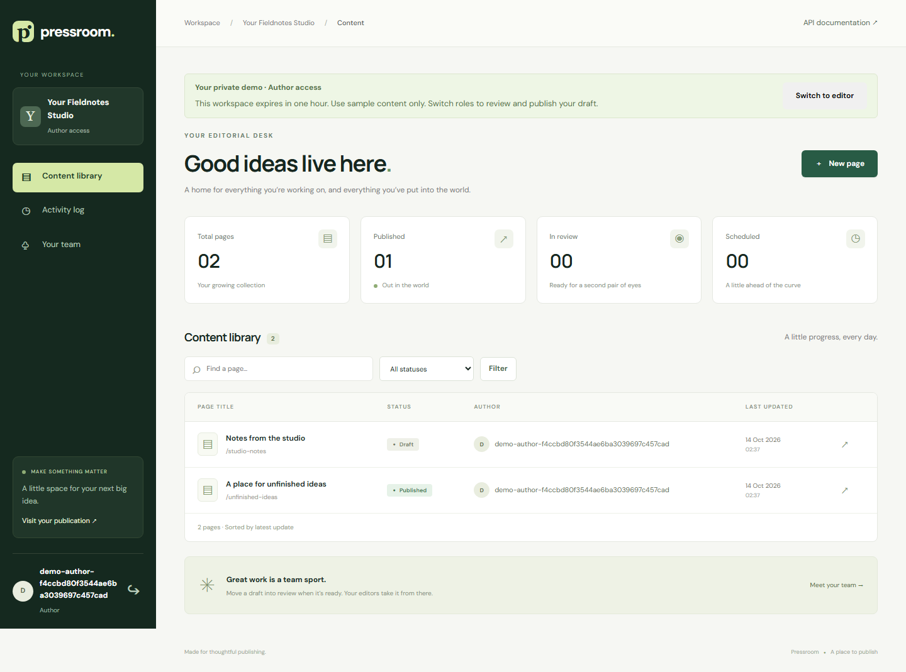
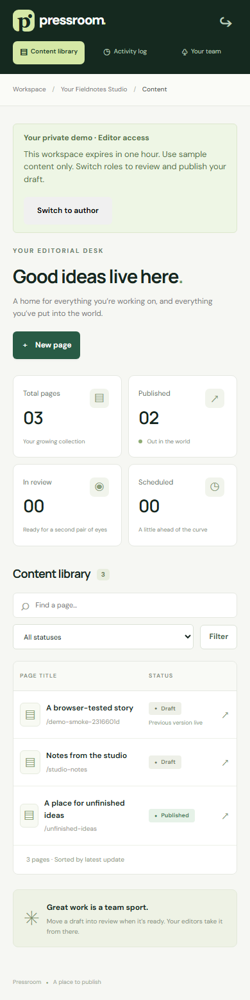

# Hosted portfolio demo

**Live:** [pressroom-demo.onrender.com/demo/](https://pressroom-demo.onrender.com/demo/). On 14 October 2026, the hosted health endpoint and a real Chromium publishing flow passed verification, including private drafts, visitor isolation and mobile layout. See [the verification record](verification.md).

## Deploy from your own Render account

The repository includes `render.yaml` for one Python web service and one PostgreSQL database. To deploy your own instance, create a Render account and review the deployment in that account.

1. Use [Deploy to Render](https://render.com/deploy?repo=https%3A%2F%2Fgithub.com%2FMohamedajab%2Fpressroom) and select the `main` branch.
2. Confirm both resources use the free plan. Render generates a 256-bit secret seed and the private database connection. Django derives its signing key from the seed; keep it stable across deployments.
3. Wait for a successful build and startup. Open the assigned HTTPS hostname with `/demo/` appended.
4. Complete draft → review → publish, inspect `/health/`, and check the maintenance logs before adding the URL to a CV.

The launcher runs migrations once before starting two Gunicorn workers. Maintenance runs `publish_due`, `cleanup_demos` and `clearsessions` every minute. It logs failures and continues; production operation still needs monitoring. Render's hostname supplies allowed hosts and trusted CSRF origins. Proxy trust is enabled for Render's HTTPS edge.

Auto-deployment is disabled so a repository push does not silently change a deployed demo. Trigger a deployment in Render after reviewing changes.

## Free-tier limitations

Render's [free web services](https://render.com/docs/free) sleep after inactivity and can take time to wake. Free PostgreSQL expires 30 days after creation. This blueprint is a temporary evaluation deployment, not permanent CV hosting. Before relying on it throughout a job search, choose a durable database plan or another host and review any charges yourself. No paid resource is created by this repository.

Scheduled publishing and cleanup pause while a free service sleeps. They resume at startup/wake. Expired authenticated demo sessions are rejected on every request even before cleanup runs. This single-service launcher is for a small demo, not a scaled scheduler architecture.

## Visitor isolation and limits

Each browser gets its own workspace and two dedicated users with unusable passwords. Role switching is CSRF-protected and restricted to those users. Users cannot choose another visitor's workspace or grant themselves access through team administration. Published demo pages remain public to anyone with their URL; all content must be synthetic.

Demo workspaces expire after one hour. Mutations have a 20 KB request limit and 60-write budget per workspace; at 100 active workspaces, new visitors receive a busy response. The capacity check is a best-effort small-demo bound, not a production rate limiter. Cleanup deletes only expired registered demos and their dedicated accounts. Real workspaces and local `seed_demo` data are preserved.

## Two-minute walkthrough

1. Start your demo. Open **A place for unfinished ideas** and its published version.
2. Edit the draft. Refresh the publication to show that unapproved text stays private.
3. Send for review, switch to editor and approve the new version.
4. Show the changed publication, revision history and activity log.




## Local browser verification

With migrations applied and `DEMO_ENABLED=true` on the running local server:

```bash
pip install -e '.[browser]'
python -m playwright install chromium
python scripts/demo_smoke.py --base-url http://127.0.0.1:8000
```

The script creates temporary workspaces, proves draft/public separation and visitor isolation, and checks the 390 px layout. It uses only sample content.
